# WFP Explorer User Guide

WFP Explorer shows the objects of the [Windows Filtering Platform](https://learn.microsoft.com/windows/win32/fwp/windows-filtering-platform-start-page) (WFP) and lets you change some of them. This guide covers each view, the property dialogs, the maps, and the options.

- [Getting started](#getting-started)
- [The main window](#the-main-window)
- [Hierarchy](#hierarchy)
- [Layer maps and callout maps](#layer-maps-and-callout-maps)
- [Object lists](#object-lists)
- [Network events](#network-events)
- [Properties](#properties)
- [Creating and deleting objects](#creating-and-deleting-objects)
- [Saving and opening](#saving-and-opening)
- [Options](#options)
- [Keyboard shortcuts](#keyboard-shortcuts)

## Getting started

Download WFP Explorer from the [Releases](https://github.com/zodiacon/WFPExplorer/releases) page and run `WFPExp.exe`. There's nothing to install.

WFP Explorer needs administrator rights, because the Base Filtering Engine (BFE) service lets only administrators read most WFP objects. Windows asks you to approve elevation when the program starts.

### A short WFP primer

Some WFP terms used in this guide:

- A **layer** is a point in the Windows network stack where WFP checks traffic, such as *ALE Connect v4* (an outgoing IPv4 connection) or *Inbound Transport v6*. Each layer defines the **fields** that filters can test, such as the remote address or the application ID.
- A **sublayer** groups filters inside a layer. Every sublayer that has filters in a layer is checked, from the highest weight to the lowest, and their decisions are combined.
- A **filter** belongs to one layer and one sublayer. It has **conditions** on the layer's fields and an **action**: permit, block, or a callout. Within a sublayer, filters are checked by **effective weight**, from highest to lowest.
- A **callout** is a function in a kernel driver that a filter can call to inspect or change traffic.
- A **provider** is the product that owns a set of objects, for example *Microsoft Corporation* or *Windows Firewall*. A **provider context** holds data that a provider attaches to its filters.
- A **session** is an open connection to the BFE. Objects added in a dynamic session are deleted when the session closes.

## The main window

Each command in the **View** menu (or its toolbar button) opens a new tab. You can open as many tabs as you like, including more than one tab of the same kind. Close the active tab with **Window > Close** (Ctrl+F4), or all of them with **Window > Close All**.

The status bar shows how many sessions, providers, filters, layers, callouts and sublayers there are. **View > Refresh** (F5) reloads the active tab. Tabs don't refresh by themselves when WFP objects change.

Most commands, such as Copy, Delete and Properties, act on the active tab. They're also on the right-click menu of the lists, trees and maps.

## Hierarchy

**View > Hierarchy** shows a tree of all the layers. Expand a layer to see its filters and callouts. The right pane shows whatever you select in the tree:

- **Layers**: the list of all layers.
- **A layer**: its layer map, described in the next section.
- **Filters** or **Callouts** under a layer: the list of that layer's filters or callouts.

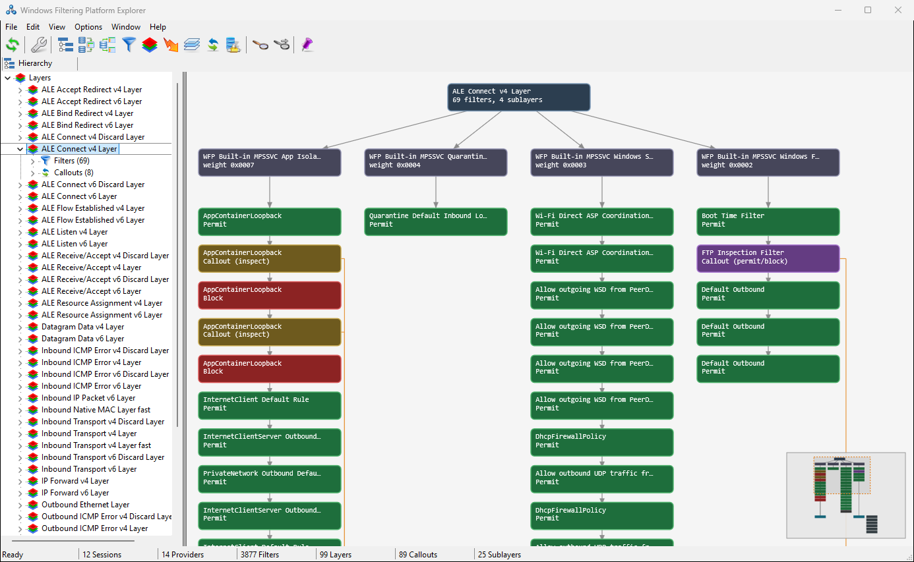

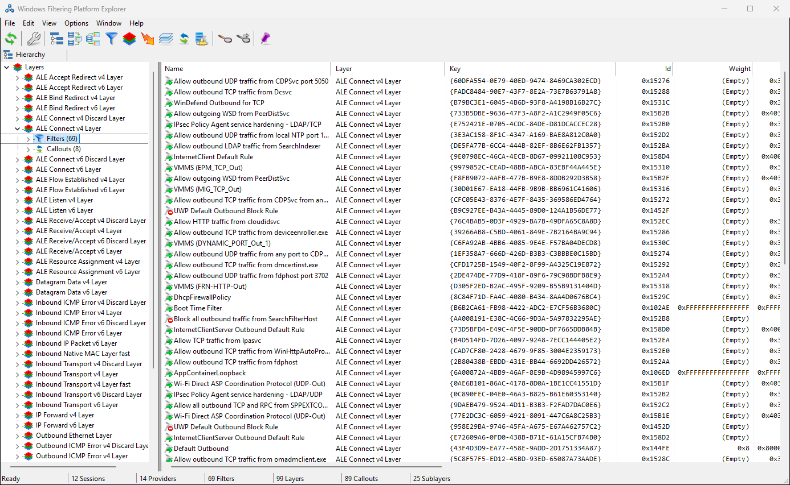

Double-click a layer, filter or callout in the tree to open its properties. When the tree has the focus, **File > Save** saves the tree as an indented text file.

## Layer maps and callout maps

A map draws WFP objects as a graph, so you can see how a layer is put together at a glance.

### Layer map

Open a layer map with **View > Layer Map**, or right-click a layer in the Layers list and select **Show Layer Map**. The list on the left shows every layer with its number of filters. Select a layer to draw its map:

- The layer is at the top.
- Below it are the layer's sublayers in the order WFP evaluates them: from the highest weight on the left to the lowest on the right.
- Under each sublayer are its filters, in evaluation order (by effective weight). Each filter shows its action. Green is permit, red is block, and the callout actions have their own colors.
- The callouts that the filters use are drawn next to them, connected to the filters that call them.

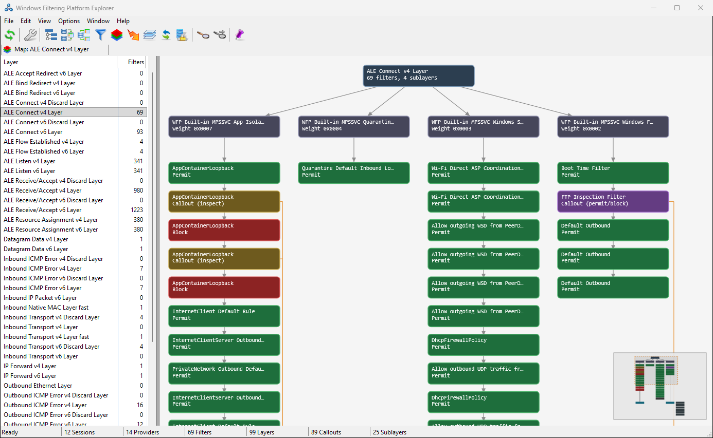

When a sublayer has more than 15 filters, the map shows the first 15 and a summary node. Double-click the summary node to show all of the sublayer's filters. Double-click it again to go back to the first 15.

Double-click any other node to open its properties. Hover over a node to see its details in a tooltip.

Right-click an empty part of the map for the map's options:

- **Hide Windows Firewall Filters**: leaves out the many filters that Windows Firewall adds, so that third-party filters stand out.
- **Color by Provider**: colors each filter and sublayer by its provider instead of its action, and adds a legend.
- **Fit to Window**: zooms the map to fit the window.
- **Save**: saves the map (see [Saving and opening](#saving-and-opening)).

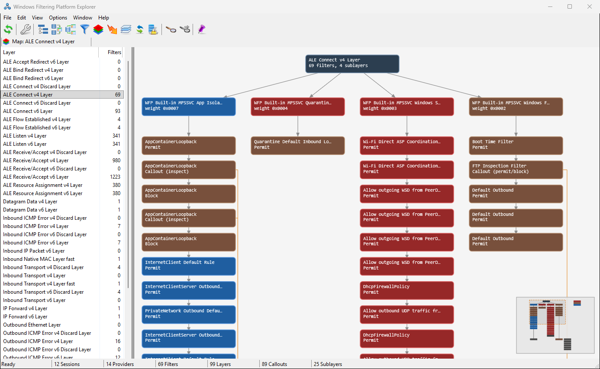

The options apply to the current map. WFP Explorer also remembers them as the default for new maps. You can also set them from the **Options** menu.

To move around a map:

- Use the mouse wheel to zoom in and out around the mouse pointer.
- Drag with the middle mouse button to pan, or drag the view rectangle in the minimap (bottom right).
- Press **F** to fit the map to the window, and **M** to show or hide the minimap.

### Callout map

**View > Callout Map** lists all callouts with the number of filters that use each one. Select a callout to see its provider, the layer it applies to, and the filters that use it, grouped by sublayer.

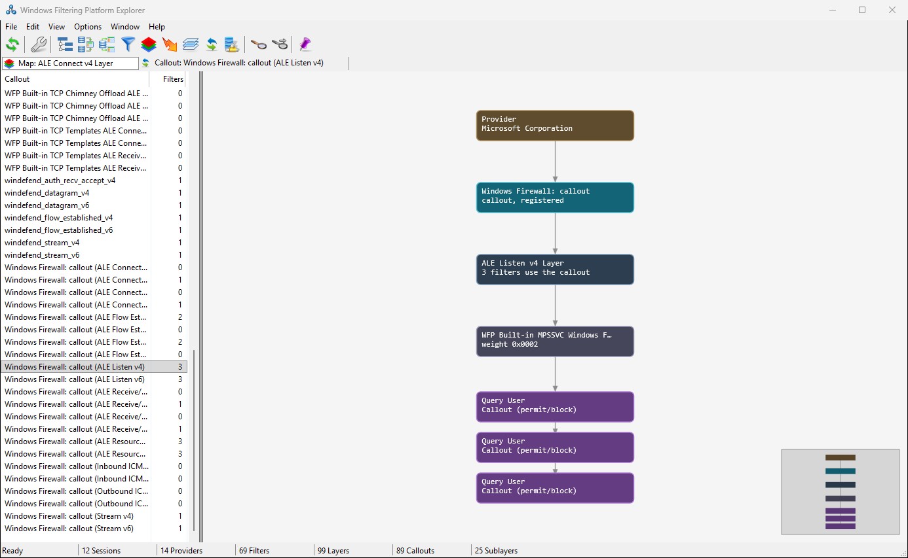

From the Callouts list, right-click a callout and select **Show Callout Map**, or **Show in Layer Map** to see the callout in the map of its layer.

A map is a snapshot. Press F5 to draw it again with the current WFP objects.

## Object lists

The **View** menu has a list for each kind of WFP object: **Sessions**, **Providers**, **Filters**, **Layers**, **Sublayers**, **Callouts** and **Provider Contexts**. All the lists work the same way:

- Click a column header to sort by that column.
- **Edit > Find** (Ctrl+F) searches the list for text, and **Find Next** (F3) finds the next match.
- **Edit > Copy** (Ctrl+C) copies the selected rows as comma-separated text.
- **File > Save** saves the whole list as a CSV file.
- Double-click a row, or press Alt+Enter, to open the object's properties.

Keys, IDs, weights and other numbers use a fixed-width font so they line up.

### Filters

All the filters in the system, with their layer, sublayer, weight and effective weight, provider, number of conditions, and action. The icon shows the action: permit, block or callout.

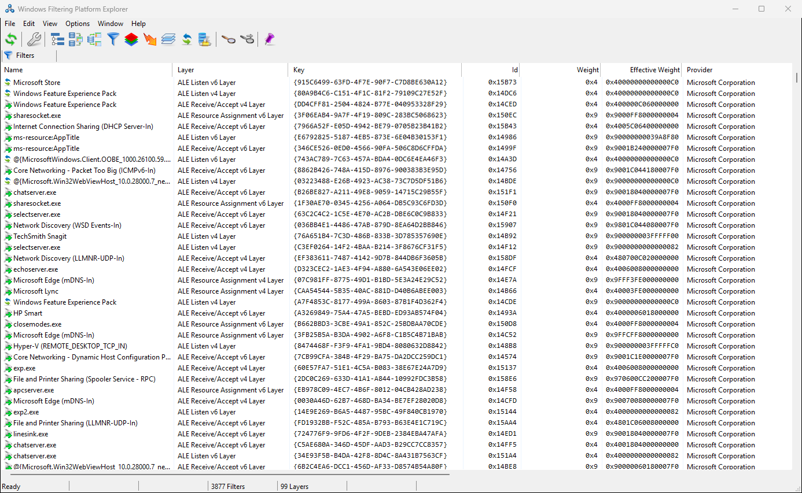

### Layers

All the layers, with their key, ID, flags, number of fields and default sublayer. Right-click a layer and select **Show Layer Map** to open its map.

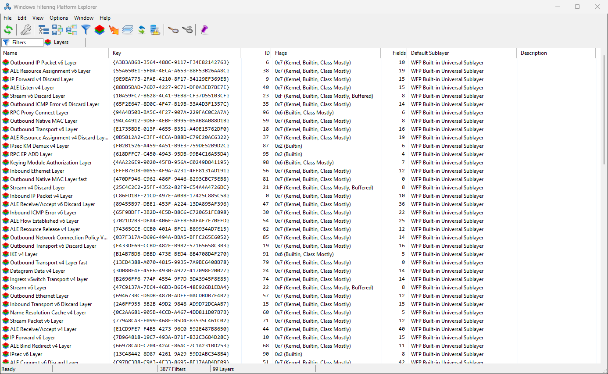

### Callouts

All the callouts, with their provider and the layer they apply to. Right-click a callout to open its callout map, or to show it in its layer's map.

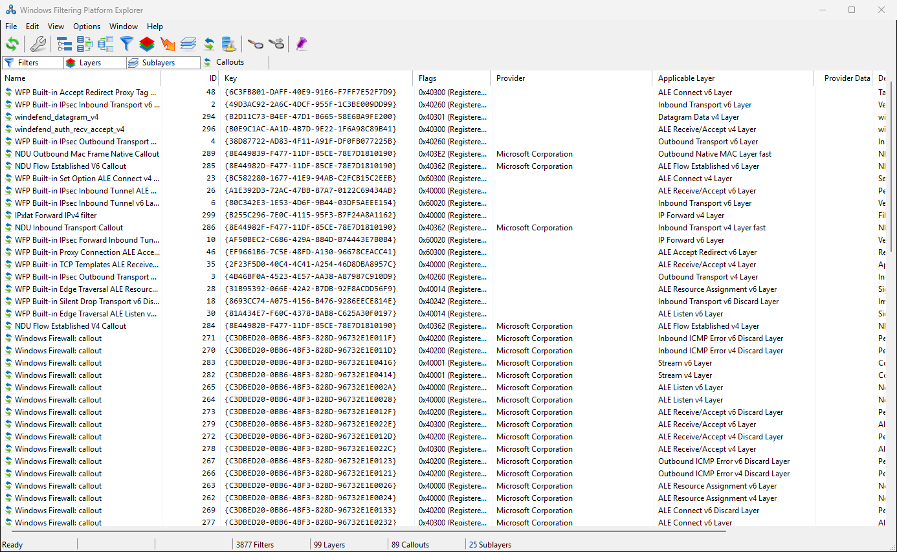

### Providers

All the providers, with their service name and flags.

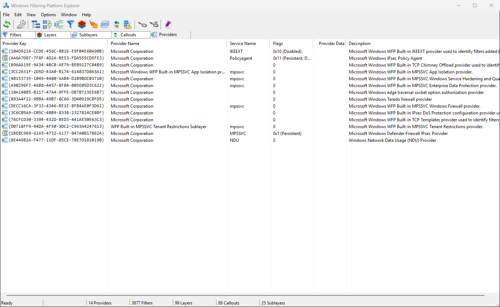

### Sessions

The open sessions to the BFE, with the process and user that opened each one, and whether it's a kernel-mode session.

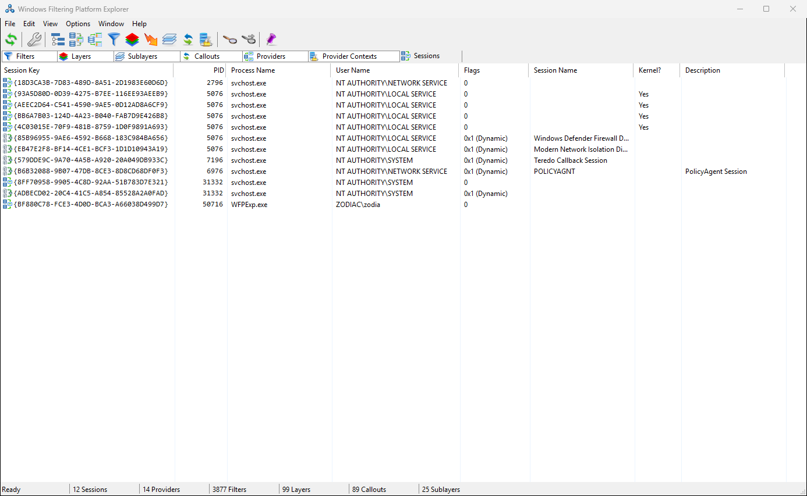

### Sublayers and Provider Contexts

**Sublayers** lists all the sublayers with their weight and provider. **Provider Contexts** lists the provider contexts with their type, size and provider.

## Network events

**View > Network Events** lists the events that the BFE has logged, such as dropped packets (*Classify Drop*), allowed connections, and IPsec failures. For each event you see the time, protocol, local and remote addresses and ports, direction, the filter and layer that caused it, and, when they apply, the application, user and package IDs.

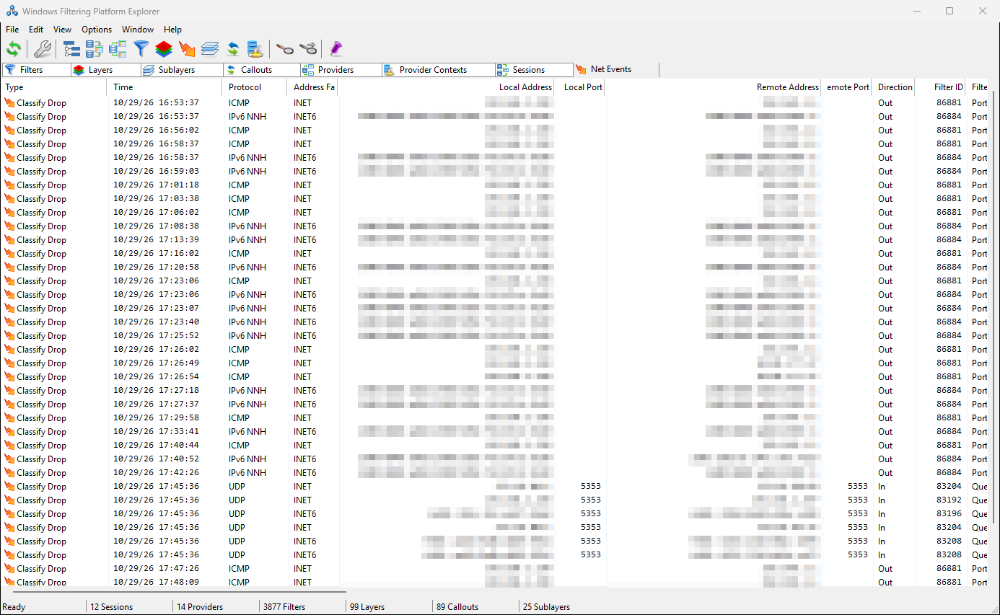

Double-click an event to see all of its details. **Copy** in the details dialog copies them as text.

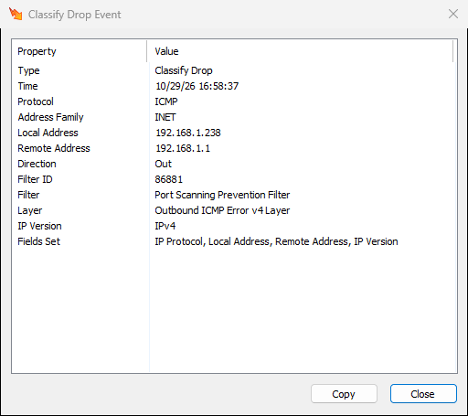

## Properties

The properties of an object open from its list, from the Hierarchy tree, from a map, or with **Edit > Properties** (Alt+Enter). You can resize the filter and layer property dialogs, and WFP Explorer remembers their size.

### Filter properties

The **General** page shows the filter's key, ID, name, flags, weight and effective weight, and action. The buttons next to the provider, layer, sublayer and callout open their properties.

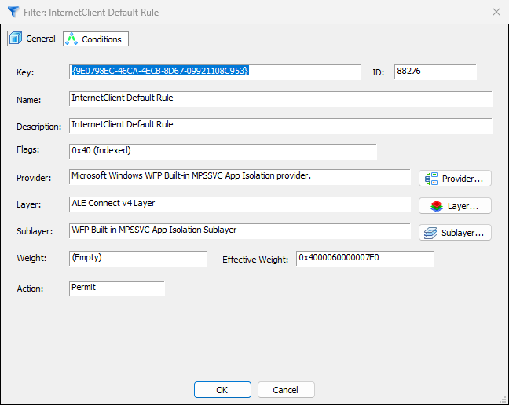

The **Conditions** page lists the filter's conditions: the field, how it's matched, the value's type, and the value. Select a condition to see its full value in the box below.

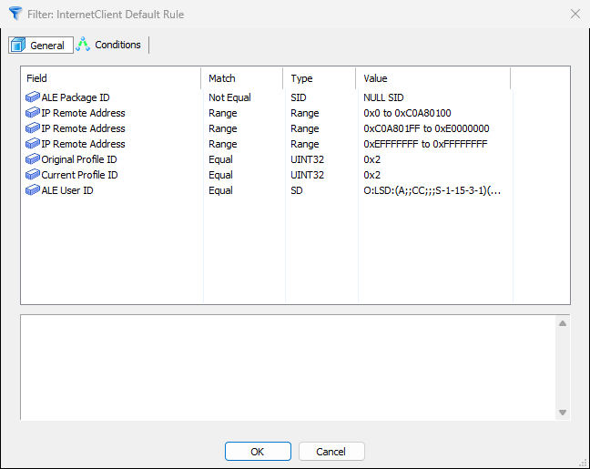

### Layer properties

The layer's property dialog has three pages:

- **General**: the layer's key, ID, name, flags and default sublayer.
- **Fields**: the fields that filters in this layer can test, with their types.
- **Filters**: the layer's filters in evaluation order. Double-click a filter to open its properties.

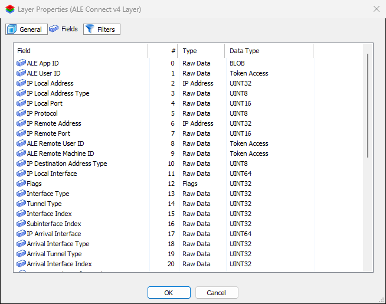

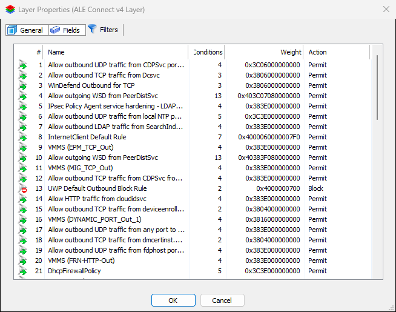

Providers, sublayers and callouts have similar property dialogs.

## Creating and deleting objects

> [!WARNING]
> Changing WFP objects changes how Windows handles network traffic. Deleting the wrong filter can open the system to traffic that was blocked, or cut off its network connection. Make changes only if you understand what they do.

**File > New** creates a **Filter**, a **Provider** or a **Sublayer**. In the New Filter dialog, select the layer, sublayer, provider, weight and action, and click **Conditions** to add conditions. **Copy From** fills the dialog from an existing filter. **Generate** creates a new key.

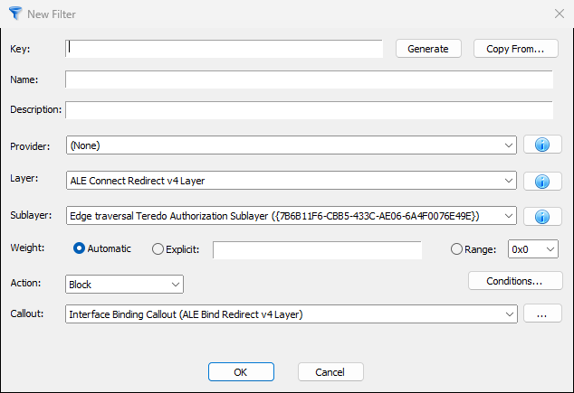

To delete filters, sublayers, providers or callouts, select them in their list and press **Delete**. WFP Explorer asks you to confirm first. WFP doesn't let you delete an object that other objects still use; for example, you must delete a sublayer's filters before you can delete the sublayer.

## Saving and opening

**File > Save** (Ctrl+S) saves the active tab:

| Tab | Saved as |
|---|---|
| Any list | CSV file |
| Hierarchy (tree focused) | Text file |
| Layer map or callout map | PNG, SVG, JPEG or BMP image, or a WFP Map file (`.wfpmap`) |

A WFP Map file keeps the whole map, not just a picture of it. **File > Open** (Ctrl+O) opens a WFP Map file in a new tab, so you can look at a map from another computer, or compare a map from before and after a change. A map opened from a file isn't connected to the WFP objects on this computer.

## Options

The **Options** menu has these settings:

- **Always On Top**: keeps the WFP Explorer window above other windows.
- **Dark Mode**: switches to a dark theme.
- **Font** and **Reset Font**: change the font of the lists and trees.
- **Map: Hide Windows Firewall Filters** and **Map: Color by Provider**: the [map options](#layer-map). With a map tab active, they change that map; otherwise they set the default for new maps.

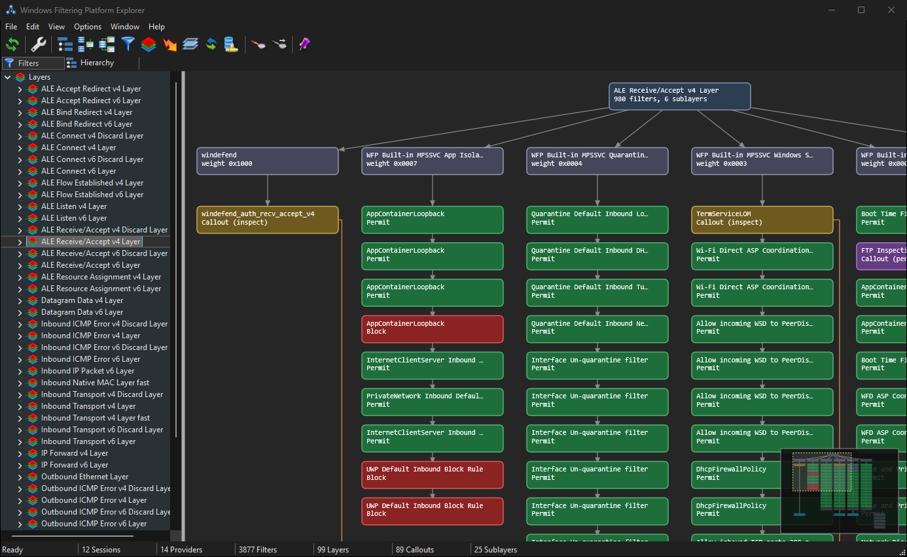

WFP Explorer saves its settings and window position in the registry, under `HKEY_CURRENT_USER\SOFTWARE\ScorpioSoftware\WFPExplorer`.

## Keyboard shortcuts

| Key | Command |
|---|---|
| F5 | Refresh the active tab |
| Ctrl+F | Find |
| F3 | Find next |
| Ctrl+C | Copy |
| Delete | Delete the selected objects |
| Alt+Enter | Properties |
| Ctrl+S | Save the active tab |
| Ctrl+O | Open a WFP Map file |
| Ctrl+F4 | Close the active tab |
| F (in a map) | Fit the map to the window |
| M (in a map) | Show or hide the minimap |
